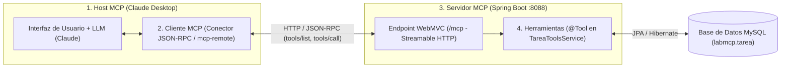

# Informe de Laboratorio: Implementación de un Servidor Model Context Protocol (MCP) con Spring Boot, Spring AI, MySQL y Claude Desktop

**Responsable:** José Luis Gil García  
**C.C:** 1034988407  
**Correo:** [j.gil@udea.edu.co](mailto:j.gil@udea.edu.co)  
**Enlace al repositorio:** [https://github.com/JoseGG8/Arquisoft](https://github.com/JoseGG8/Arquisoft)  

---

## 1. Introducción

En la evolución reciente de las aplicaciones asistidas por Inteligencia Artificial generativa, uno de los mayores desafíos consistía en conectar modelos de lenguaje grande (LLM) con fuentes de datos vivas y sistemas corporativos sin caer en integraciones propietarias o acopladas a un único proveedor. Para resolver esta fragmentación nació el estándar **Model Context Protocol (MCP)**, un protocolo abierto que estandariza la forma en que una aplicación cliente de IA (como Claude Desktop o agentes autónomos) descubre y ejecuta herramientas (*tools*), recursos y prompts expuestos por servidores externos.

El presente laboratorio se centra en la construcción completa y detallada de un servidor MCP desarrollado en Java mediante **Spring Boot 3** y **Spring AI**. A través de esta arquitectura, un asistente de IA adquiere capacidades transaccionales directas sobre una base de datos relacional **MySQL** para gestionar un catálogo de tareas (CRUD) en lenguaje natural, aprovechando la infraestructura moderna del ecosistema Spring para la exposición de endpoints HTTP Streamable y el desacoplamiento de la lógica de negocio.

---

## 2. Objetivos

### 2.1. Objetivo General
Diseñar, construir y desplegar un servidor Model Context Protocol (MCP) funcional basado en Spring Boot 3 y Spring AI WebMVC, capaz de interactuar con una base de datos MySQL para la gestión de tareas e integrarse con Claude Desktop como cliente anfitrión para la ejecución de herramientas en lenguaje natural.

### 2.2. Objetivos Específicos
* Configurar un proyecto base en Spring Boot alineando las versiones de JDK (Java 23), Spring Boot y las librerías del ecosistema Spring AI MCP Server WebMVC.
* Estructurar la persistencia relacional con Spring Data JPA y MySQL para el dominio de tareas, garantizando consistencia y control de concurrencia optimista.
* Exponer operaciones de lectura y modificación como herramientas MCP mediante anotaciones `@Tool` y `@ToolParam`.
* Conectar Claude Desktop al servidor local mediante el protocolo Streamable HTTP a través de `mcp-remote`.
* Implementar herramientas analíticas de conteo (`contarTareas`) y filtrado complementario (`listarCompletadas` frente a `listarPendientes`).
* Blindar la integridad de los datos validando fechas bajo el estándar estricto ISO `yyyy-MM-dd`.
* Modelar conceptualmente la arquitectura MCP y comparar la interoperabilidad frente a múltiples clientes anfitriones como Google ADK.

---

## 3. Herramientas y Tecnologías

* **Plataforma y Lenguaje:** Java 23 (Oracle JDK 23.0.2), Apache Maven 3.9 / Maven Wrapper 3.10.0.
* **Framework Backend:** Spring Boot 3.5.11, Spring Framework 6.2.16.
* **Ecosistema de IA:** Spring AI Starter MCP Server WebMVC 1.1.4, MCP Java SDK 0.17.0.
* **Persistencia y Base de Datos:** Spring Data JPA, Hibernate ORM 6.6.42, MySQL Server 8.0.42 Community Edition, MySQL Connector/J 9.6.0.
* **Cliente / Anfitrión MCP:** Claude Desktop (Windows x64), Node.js v24.15.0, `mcp-remote` (npx).

---

## 4. Metodología y Procedimiento de Construcción

### 4.1. Creación del Proyecto Base en Spring Initializr
El punto de partida fue acceder a `start.spring.io` para generar el esqueleto de la aplicación. Se definió un proyecto Maven con lenguaje Java, empaquetado Jar y metadatos de grupo `com.example` y artefacto `labmcp`. Se seleccionaron las dependencias esenciales: *Spring Data JPA* (acceso a datos), *Spring Web* (servidor web embebido Tomcat y despacho HTTP), *Validation* (Bean Validation para entidades), *MySQL Driver* (conector JDBC nativo) y *Spring Boot DevTools*. Una vez descargado el archivo comprimido, se descomprimió en la carpeta de trabajo del curso bajo el nombre `MCP_server`.

### 4.2. Ajuste de Dependencias y Resolución de Inconsistencias en `pom.xml`
Al inspeccionar el entorno local se constató que la máquina tenía instalado únicamente **Oracle JDK 23.0.2**. El archivo `pom.xml` original requería dos ajustes críticos para evitar advertencias de compilación y choques de versiones:
* Se actualizó la propiedad `<java.version>` de `21` a `23`, permitiendo que el compilador utilizara la bandera `--release 23` nativa del JDK instalado.
* Se integró la dependencia del iniciador MCP de Spring AI: `spring-ai-starter-mcp-server-webmvc` (versión `1.1.4`) gestionada a través de su BOM (`spring-ai-bom`). Debido a que los módulos de Spring AI 1.1.4 están construidos nativamente sobre **Spring Boot 3.5.11**, se elevó el `spring-boot-starter-parent` desde la versión 3.4.7 a la 3.5.11. Esto garantizó que dependencias compartidas como Jackson (2.19.4), Micrometer (1.15.9) y Spring Core (6.2.16) se resolvieran armónicamente sin degradaciones involuntarias.

### 4.3. Aprovisionamiento de la Base de Datos MySQL y Script Inicial
Con el servicio local de Windows `MySQL80` en ejecución, se utilizó el cliente CLI de MySQL para crear el esquema relacional. Se ejecutó el script `schema.sql`, el cual contiene la sentencia `CREATE DATABASE IF NOT EXISTS labmcp` con codificación UTF-8, la creación de la tabla `tarea` con su clave primaria autoincremental, el campo de versión para bloqueo optimista, y la inserción inicial de 3 registros representativos (dos tareas pendientes y una completada) para facilitar la verificación funcional inmediata.

### 4.4. Configuración del Entorno en `application.properties`
Se editaron las propiedades de la aplicación para enlazar la base de datos y publicar el servidor MCP:
* **Conexión JDBC:** URL apuntando a `jdbc:mysql://localhost:3306/labmcp`, usuario `root` y clave configurable por variable de entorno o vacía por defecto: `${PWD_UDEA:}`.
* **Hibernate:** Modo `spring.jpa.hibernate.ddl-auto=update` para mantener sincronizadas las tablas y dialecto de MySQL.
* **Parámetros MCP:** Se fijó `server.port=8088`, nombre de aplicación `labmcp`, protocolo `spring.ai.mcp.server.protocol=streamable` y `spring.ai.mcp.server.stdio=false`. Con esta configuración, Spring AI habilita de forma automática el endpoint HTTP en la ruta `http://localhost:8088/mcp`.

### 4.5. Construcción de la Capa de Dominio, Repositorio y Servicio
El código Java se implementó de forma modular siguiendo la arquitectura tradicional de Spring:
* **Entidad `Tarea` (Modelo):** Clase mapeada con JPA mediante `@Entity` y `@Table(name="tarea")`. Cuenta con identificador `id` autoincremental, `titulo` obligatorio (`@NotBlank`), `fecha` en cadena, bandera booleana `completado` y el campo `@Version private Long version` para evitar colisiones por escrituras concurrentes.
* **Repositorio `TareaRepository`:** Interfaz que extiende `JpaRepository<Tarea, Long>`, aprovechando la generación dinámica de consultas de Spring Data para declarar `findByCompletado(Boolean completado)` y `findByTituloContainingIgnoreCase(String fragmento)`.
* **Servicio de Herramientas `TareaToolsService`:** Componente Spring (`@Component`) donde cada método público de negocio se expone al ecosistema de IA anotándolo con `@Tool`. A través de `@ToolParam` se documenta semánticamente cada argumento. El servicio implementa la operativa CRUD básica: `listTareas`, `listPendientes`, `buscarTareas`, `crearTarea`, `markComplete`, `updateTarea` y `eliminarTarea`.
* **Publicador en `LabmcpApplication`:** En la clase principal se configuró el Bean `ToolCallbackProvider` mediante `MethodToolCallbackProvider.builder().toolObjects(tools).build()`, escaneando los métodos anotados en el servicio para registrarlos en el catálogo MCP.

### 4.6. Configuración e Integración con Claude Desktop
Para que Claude Desktop pudiera consumir las herramientas alojadas en nuestro servidor HTTP en el puerto 8088, se editó el archivo de configuración `claude_desktop_config.json` ubicado en la ruta del paquete de la aplicación en Windows (`%LOCALAPPDATA%\Packages\Claude_...\LocalCache\Roaming\Claude\`). Dado que Claude Desktop se comunica primordialmente mediante entrada/salida estándar (stdio), se empleó la utilidad `mcp-remote` ejecutada vía `npx` como puente transparente hacia el endpoint HTTP:

```json
"mcpServers": {
  "labmcp": {
    "command": "npx",
    "args": [
      "-y",
      "mcp-remote",
      "http://localhost:8088/mcp"
    ]
  }
}
```

### 4.7. (Punto 10) Incorporación de la Herramienta `contarTareas` y Análisis de su Descripción MCP
Se agregó al servicio la herramienta encargada de cuantificar los elementos almacenados:

```java
@Tool(name = "contarTareas", description = "Devuelve el número total de tareas registradas en la base de datos (tanto pendientes como completadas).")
public long contarTareas() {
    return repo.count();
}
```

**Explicación de la descripción MCP:** En el protocolo MCP, la descripción no es un simple comentario legible por humanos, sino el *prompt contextual* que el modelo de lenguaje (LLM) evalúa durante el proceso de *function calling*. Al indicar con claridad que devuelve el número total e incluir la precisión "(tanto pendientes como completadas)", el LLM comprende que ante una pregunta como "¿cuántas tareas tengo?", no requiere descargar toda la lista de tareas en memoria con `listTareas`, sino invocar directamente `contarTareas`. Esto traslada la carga de cómputo al motor de base de datos ejecutando un eficiente `SELECT COUNT(*)` y optimiza el consumo de tokens en la ventana de contexto del LLM.

### 4.8. (Punto 11) Implementación de `listarCompletadas` y Comparación con `listarPendientes`
Se diseñó la herramienta complementaria para obtener exclusivamente las tareas finalizadas:

```java
@Tool(name = "listarCompletadas", description = "Devuelve únicamente las tareas completadas (completado = true).")
public List<Tarea> listarCompletadas() {
    return repo.findByCompletado(true);
}
```

**Comparativa entre ambas herramientas:**

| Criterio | `listarPendientes` | `listarCompletadas` |
| --- | --- | --- |
| **Consulta JPA** | `repo.findByCompletado(false)` | `repo.findByCompletado(true)` |
| **Filtro SQL** | `WHERE completado = 0` | `WHERE completado = 1` |
| **Registros actuales** | 2 tareas ("Preparar charla MCP", "Revisar slides") | 1 tarea ("Probar demo en vivo") |
| **Relación lógica** | Constituyen conjuntos disjuntos y complementarios. Su suma aritmética (2 + 1 = 3) coincide exactamente con el valor entregado por `contarTareas`. |

### 4.9. (Punto 12) Validación Estricta de Formato de Fecha ISO `yyyy-MM-dd`
Originalmente el campo fecha admitía cadenas arbitrarias. Se implementó una rutina privada de validación que combina comprobación por expresión regular y análisis estricto de calendario:

```java
private void validarFechaIso(String fecha) {
    if (fecha == null || !fecha.matches("\\d{4}-\\d{2}-\\d{2}")) {
        throw new IllegalArgumentException(
            "La fecha '" + fecha + "' no es válida. Debe tener el formato ISO yyyy-MM-dd (p.ej. 2026-04-20).");
    }
    try {
        LocalDate.parse(fecha);
    } catch (DateTimeParseException e) {
        throw new IllegalArgumentException(
            "La fecha '" + fecha + "' no es una fecha de calendario válida en formato ISO yyyy-MM-dd.", e);
    }
}
```

Esta función fue integrada al inicio de `crearTarea` y condicionalmente en `actualizarTarea` (únicamente cuando el usuario aporta una nueva fecha no nula). Se actualizaron además las descripciones en `@ToolParam` para que el cliente MCP transmita desde el inicio fechas con la estructura requerida.

### 4.10. (Punto 13) Arquitectura Conceptual del Ecosistema MCP



**Definición precisa de roles:**
* **Host MCP (Anfitrión):** Es el software global que gestiona la experiencia del usuario y orquesta la interacción con el modelo de lenguaje (en este caso, la aplicación de escritorio Claude Desktop). Posee la ventana de contexto y decide cuándo necesita invocar recursos externos.
* **Cliente MCP:** Componente de comunicación embebido en el anfitrión que implementa la especificación cliente del protocolo. Mantiene una conexión dedicada (uno a uno) con un servidor MCP específico, envía mensajes de inicialización y despacha las peticiones remotas `tools/list` y `tools/call` en formato JSON-RPC.
* **Servidor MCP:** Proceso independiente (nuestro backend Spring Boot en el puerto 8088) que publica servicios siguiendo el estándar MCP. Recibe las peticiones remotas del cliente, valida los tipos de entrada y despacha la ejecución hacia las herramientas internas.
* **Herramienta (Tool):** Unidad atómica y ejecutable de funcionalidad expuesta por el servidor (los métodos anotados con `@Tool` en `TareaToolsService`). Cada herramienta posee nombre, descripción contextual y un esquema de parámetros, actuando como un puente directo hacia las operaciones CRUD sobre MySQL.

### 4.11. (Punto 14) Comparativa de Clientes: Claude Desktop frente a Google ADK
Una de las principales ventajas de adoptar MCP es la absoluta independencia del proveedor de inteligencia artificial. Al contrastar **Claude Desktop** con **Google GenAI Agent Development Kit (Google ADK / Gemini)** como clientes del mismo servidor, se desprenden las siguientes conclusiones:
* **¿Qué parte del código se reutiliza?:** Se reutiliza el **100% del código del servidor backend**. Toda la lógica de entidades JPA, repositorios, servicios, anotaciones `@Tool`, validación de fechas ISO, conexión a base de datos y endpoints de transporte HTTP permanece intacta. El servidor es agnóstico a qué cliente lo consume.
* **Diferencias en el cliente:** En Claude Desktop la integración se realiza de forma declarativa mediante el archivo `claude_desktop_config.json` con el bridge `mcp-remote`. En Google ADK la integración se realiza mediante código programático (en Python o TypeScript), instanciando un cliente MCP que se suscribe al endpoint `http://localhost:8088/mcp` y mapea automáticamente el catálogo de herramientas hacia la interfaz de *Function Calling* de los modelos Gemini.

### 4.12. Análisis de Riesgo de Seguridad y Propuestas de Mitigación
**Riesgo Identificado: Invocación Arbitraria y Ejecución Remota No Autorizada de Herramientas sobre HTTP sin Autenticación.**  
Al exponer un servidor MCP sobre el protocolo Streamable HTTP en el puerto 8088 sin una capa de seguridad perimetral ni credenciales, cualquier proceso o usuario dentro de la misma red local (o en la misma máquina a través de ataques web como *DNS Rebinding* o peticiones desde scripts en el navegador) puede enviar peticiones JSON-RPC al endpoint `/mcp`. Esto representa un peligro mayúsculo, pues un actor no autorizado podría:
* Extraer información confidencial invocando `listTareas` o `buscarTareas`.
* Modificar o corromper registros mediante `updateTarea`.
* Destruir la base de datos llamando reiteradamente a `eliminarTarea` con identificadores arbitrarios.

**Estrategias de Mitigación Propuestas:**
1. **Autenticación y Autorización HTTP (Bearer Tokens / API Keys):** Implementar Spring Security para exigir una cabecera `Authorization: Bearer <token>` en cada solicitud HTTP hacia `/mcp`, validando tokens JWT firmados criptográficamente.
2. **Aislamiento de Transporte (Modo STDIO):** Para escenarios de uso personal en escritorio, utilizar el transporte estándar `stdio` en lugar de sockets de red HTTP. En este esquema, el anfitrión (Claude Desktop) inicia el proceso de Spring Boot como subproceso hijo y la comunicación fluye exclusivamente mediante tuberías (pipes) del sistema operativo, eliminando cualquier vector de ataque por red.
3. **Enlace Exclusivo a Loopback:** En caso de mantener el servidor HTTP, configurar el enlace de red exclusivamente a `127.0.0.1` (evitando `0.0.0.0`) y habilitar validación de cabeceras de origen (CORS) para bloquear invocaciones originadas desde páginas web maliciosas.
4. **Control de Acceso Basado en Roles (RBAC):** Separar permisos en el catálogo MCP, exigiendo roles administrativos específicos para herramientas destructivas (como `eliminarTarea`).

---

## 5. Resultados

1. **Servidor MCP Completamente Operativo:** El backend en Spring Boot 3.5.11 compila limpiamente bajo Java 23 y levanta en el puerto 8088, registrando exitosamente en consola **9 herramientas MCP** accesibles vía JSON-RPC.
2. **Persistencia Relacional Integrada:** Operaciones CRUD plenamente funcionales sobre MySQL 8.0 local, con bloqueo optimista mediante `@Version` y persistencia verificada.
3. **Integración con Claude Desktop:** Vinculación transparente mediante el bridge `mcp-remote` en el archivo de configuración de Claude, permitiendo que el LLM gestione las tareas mediante lenguaje natural.
4. **Blindaje de Reglas de Negocio:** Validación estricta de fechas bajo estándar ISO `yyyy-MM-dd`, impidiendo la persistencia de datos inconsistentes.
5. **Completitud Funcional de las Herramientas:** Capacidades analíticas de conteo (`contarTareas`) y filtrado especializado (`listarCompletadas` y `listarPendientes`) plenamente disponibles para el asistente de IA.

---

## 6. Conclusiones

* **Estandarización del contexto con MCP:** Model Context Protocol desacopla exitosamente las capacidades computacionales y de almacenamiento de la lógica del modelo de lenguaje. Desarrollar servidores MCP en Spring AI permite transformar cualquier API empresarial en un conjunto de herramientas utilizables por cualquier IA del mercado.
* **El valor semántico de las descripciones:** En MCP, la documentación de métodos y parámetros (`@Tool` y `@ToolParam`) constituye el contrato de decisión para el LLM. Redactar descripciones precisas, como en `contarTareas` o en las restricciones de fecha ISO, previene llamadas erróneas y reduce el consumo de tokens y ancho de banda.
* **Reutilización absoluta entre clientes:** El diseño agnóstico de MCP garantiza que el 100% del código desarrollado en el servidor se reutiliza idénticamente sin importar si el anfitrión es Claude Desktop, Google ADK u orquestadores en la nube.
* **Desarrollo natural y modular:** La integración fluida entre Spring Boot, JPA y Spring AI permite implementar soluciones avanzadas de interacción con IA manteniendo la simplicidad arquitectónica y la separación clara de responsabilidades en el backend.
